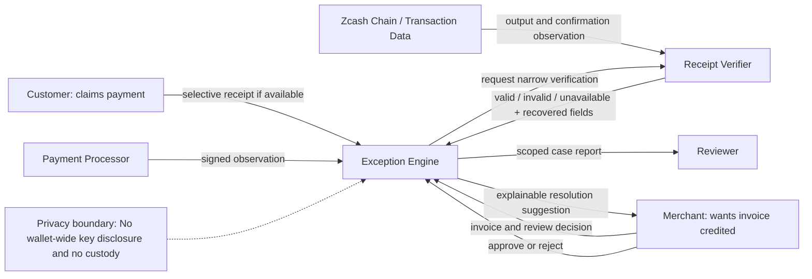
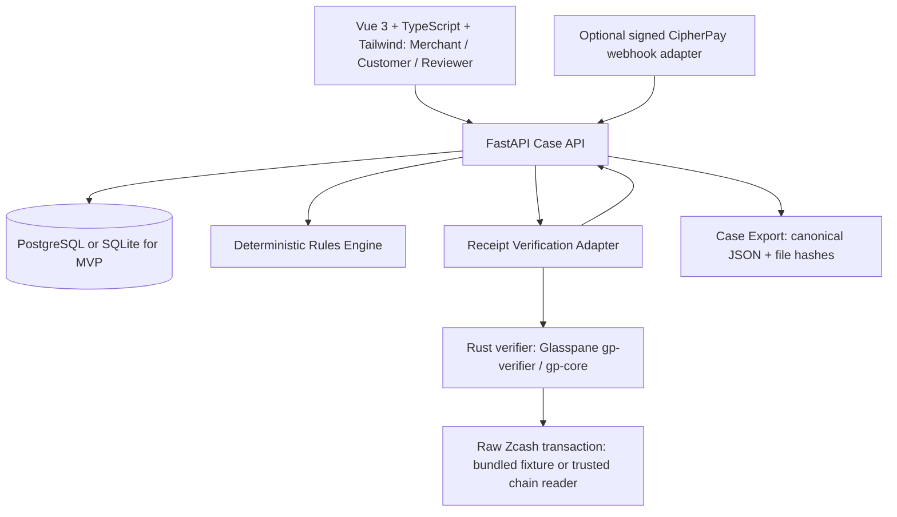

# Shielded Payment Exception Engine — Hackathon Blueprint

**Target:** Colosseum Crypto World's Fair 2026, Zcash track  
**Prepared:** 2026-10-10  
**Stage:** Build-ready proposal, not evidence of market validation or production readiness.

## Elevator pitch

Resolve Zcash shielded-payment exceptions without giving customer support, accountants, or reviewers access to an entire wallet. The product ingests invoice records, payment observations and optional selective-disclosure receipts; it classifies the evidence, prevents duplicate invoice credit, and produces an explainable resolution record. It **does not hold, reverse, or move ZEC**.

## Opportunity and prior art

- CipherPay already provides payment links, invoices, checkout, monitoring, refunds APIs, and signed webhooks. Do not rebuild these. https://github.com/atmospherelabs-dev/cipherpay-api
- Zink provides non-custodial invoice links, but documents missing partial/overpayment and refund functionality. https://github.com/KaranSinghBisht/zink
- Glasspane provides receipt issuing, Orchard/Sapling cryptographic verification, tamper detection, and replayable packets. Reuse its existing primitives subject to compatibility/licensing verification. https://github.com/dolepee/glasspane
- ZecLedger handles view-only wallet accounting and flags partial matches. https://github.com/vancube2/zecledger
- shielded.bid documents real-world manual review of conflicting settlement, duplicate evidence, amount mismatches, and refunds, which suggests a workflow problem but does **not** establish demand for an independent SaaS. https://www.shielded.bid/refunds

**Proposed wedge:** merchant-facing case management + structured evidence hierarchy + output-level replay protection + deterministic resolution suggestions + portable case record. This is a hypothesis, not a first-in-market claim.

## Personas

**Merchant:** owns the invoice, chooses policy and final credit/refund decision.  
**Customer:** may make a payment claim and optionally disclose a receipt.  
**Reviewer:** examines a scoped case report without accessing spending or full viewing keys.  
**Payment processor:** supplies signed payment or invoice observations, not cryptographic proof of all assertions.  
**Zcash network/indexer:** supplies raw transaction data and external confirmation observations.

## Scope (deadline-first)

### P0 — Hackathon MVP

1. Enter/import one invoice with immutable snapshot: expected recipient, amount in zatoshis, reference/memo, expiry.
2. Create an exception case; customer submits a claim and optional per-output receipt.
3. Verify an Orchard/Sapling Glasspane receipt against an actual historical Zcash raw transaction; separately fetch/label chain confirmation observation when supported.
4. Classify **UNDERPAYMENT**, **DUPLICATE_OUTPUT_CLAIM**, **INVALID_RECEIPT**; distinguish lack of evidence from invalid evidence.
5. Display a clear evidence report, merchant-reviewed resolution, and downloadable JSON case packet.
6. Reproduce a passing mainnet fixture and negative fixture reliably in tests and on the demo machine.

### P1 — Nice to have

Missing memo / late payment / overpayment, authenticated CipherPay invoice webhook adapter, notifications, signed merchant report, browser-local WASM verifier, CSV export.

### Out of scope

Building a new payment gateway or wallet, custody/spending keys, automatic refunds or escrow, Ironwood-native receipt generation, legal identity verification, proof of financial-statement completeness, regulation-grade audit opinion.

## Rich picture — relationships, evidence and tension



## Architecture — hackathon deployment



**Deploy fastest:** Vue frontend on Vercel, FastAPI and pinned Rust CLI in one Docker container, SQLite for POC or managed PostgreSQL if already provisioned. Use a bounded subprocess invocation (`shell=False`, timeout, limited input file size, isolated temp directory), not arbitrary shell execution. Keep a stable interface so verification can move to a queue or WASM later.

**Real-world trust boundaries:** the app cannot independently prove all processor assertions; the merchant's resolution is a business decision, not a cryptographic fact. Raw-tx output recovery alone does not prove chain inclusion; label block/confirmation separately and fetch from a trustworthy Zcash source when needed. Receipts can be forwarded and reverified indefinitely after disclosure.

## Data model

Use integer **zatoshis**, never floating-point currency quantities. One zatoshi = 10^-8 ZEC.

| Table | Fields (essential) | Constraints |
|---|---|---|
| `invoices` | `id, merchant_id, network, expected_zat, expected_receiver, expected_memo, expires_at, snapshot_hash` | Immutable version after a case opens |
| `cases` | `id, invoice_id, category, state, assigned_to, created_at` | Resolution separate from proof status |
| `claims` | `id, case_id, claimant_role, reported_txid, note, created_at` | Claim is never treated as verified truth |
| `evidence` | `id, case_id, type, source, sha256, storage_ref, submitted_at` | Private by default; content limits |
| `verifications` | `id, evidence_id, network, pool, txid, output_index, chain_state, receipt_state, recovered_zat, recovered_receiver, recovered_memo, rules_result` | Preserve verifier version and errors |
| `output_allocations` | `network, pool, txid, output_index, invoice_id, credit_state` | Unique output ID when credited: prevent double-use |
| `case_events` | `case_id, actor, action, at, payload_hash, previous_hash` | Append-only logical event history |
| `resolutions` | `id, case_id, outcome, reason, approved_by, approved_at` | Human action, not inferred from receipt success |

Normalize Unified Addresses and compare the actual shielded receiver components where necessary, not naive string equality of different Unified Address encodings. Output identity: `network:pool:txid:output_index`. For P0, enforce one output credits at most one invoice; explicit split allocations are later work.

## API contract (proposed)

```text
POST   /api/invoices
POST   /api/cases
GET    /api/cases/{id}
POST   /api/cases/{id}/claims
POST   /api/cases/{id}/evidence
POST   /api/cases/{id}/verify
POST   /api/cases/{id}/resolve
GET    /api/cases/{id}/export
POST   /api/integrations/cipherpay/webhook    [P1; HMAC validation]
```

Suggested case states: `OPEN`, `AWAITING_EVIDENCE`, `UNDER_REVIEW`, `RESOLVED`, `CLOSED_UNRESOLVED`. Keep **orthogonal** `receipt_state` = `NONE|VALID|INVALID|ERROR|UNAVAILABLE`, `match_state` = `MATCH|UNDERPAID|OVERPAID|RECIPIENT_MISMATCH|MEMO_MISMATCH|DUPLICATE_CLAIM|UNKNOWN`, `chain_state` = `CONFIRMED|UNCONFIRMED|UNAVAILABLE`. A valid receipt is never by itself a completed business resolution.

## Rules engine (deterministic, non-accusatory)

```text
IF receipt is missing OR verification cannot run -> INSUFFICIENT_EVIDENCE (not INVALID)
IF output recovery or tx binding fails -> INVALID_EVIDENCE (not fraud accusation)
IF chain inclusion is unknown -> CHAIN_UNVERIFIED (do not assert confirmed)
IF recovered receiver conflicts with invoice receiver -> RECIPIENT_MISMATCH
IF output already credited to another invoice -> DUPLICATE_CLAIM, no auto-credit
IF confirmed matched output amount < invoice expected -> UNDERPAID, show difference
IF confirmed matched output amount > invoice expected -> OVERPAID, request review
IF memo missing/incorrect AND no unique recipient binding -> NEEDS_REVIEW
IF all relevant checks pass -> ELIGIBLE_FOR_CREDIT (merchant must approve)
```

A single sender transaction may contain multiple outputs; **do not use txid alone** to deduplicate. A payer's identity or intent is not proven by an output receipt.

## Security and privacy requirements

| Threat | Mitigation in MVP |
|---|---|
| Fake provider callback | HMAC signature, timestamp window, nonce/event-id idempotency; never trust unverified body |
| Duplicate claim or replay | Unique output ID, transaction-level DB lock/constraint, explicit conflict state |
| Tampered receipt | Verify txid, pool, output index and OCK recovery against raw transaction |
| Invoice edited after claim | Immutable snapshot/version digest; record edits as new version and require re-review |
| Leaked customer details | Minimize evidence, encrypt storage, role-based access, redact logs, protect signed URLs |
| Misleading proof claims | Three independent statuses: chain observation, receipt verification, business resolution |
| Untrusted raw chain source | Explicit source provenance; record observed height and timestamp; don't call offline raw-tx a proof of inclusion |
| Operator abuse | Record human actions in append-only audit events, least privilege, dual review later |

Note that a self-generated signature/hash on an audit packet protects integrity relative to a trusted key; it does **not** by itself prove the underlying invoice or merchant assertions are truthful.

## Demo plan (show what is actually verified)

**Scene 1 — underpayment:** create a *synthetic imported invoice* for 0.002 ZEC against a previously verified historical Zcash mainnet receipt of 0.001 ZEC. Demonstrate verification of the output and a deterministic 0.001 ZEC shortfall. Explain that this is a scenario constructed over a real chain fixture, **not** a newly initiated checkout.

**Scene 2 — duplicate claim:** upload the same valid output-specific receipt to a different invoice; the system detects that the output has already been credited elsewhere and blocks a second credit.

**Scene 3 — tamper:** mutate receipt OCK or output index; verifier rejects it, reports why, and never marks the invoice paid.

**End:** reviewer receives a report showing evidence provenance, verified amount/recipient/memo when disclosed, exception classification, limits of proof, and the human resolution. If the demo runs without live chain access, show `raw_tx_verified` and an honest separately labeled `chain_observation` field instead of claiming online confirmation.

Glasspane demo references: `examples/mainnet-receipt.json` + `examples/mainnet-tx.hex` and the tampered row in `examples/rooms/zechub-demo`. The current documented parser is NU5–NU6.2; **do not claim Ironwood NU6.3 native support** without additional implementation/testing.

## Sprint schedule

| Date (WIB) | Priority | Ship criterion |
|---|---|---|
| Oct 10 afternoon/evening | Repo, Rust verifier POC, database + rules schema | Valid historical mainnet fixture passes; tampered fails |
| Oct 11 morning | Case endpoints, evidence upload, 3 rule branches | Automated tests for underpay, duplicate, tamper |
| Oct 11 evening | Merchant dashboard + customer submit + reviewer report | End-to-end UI flow without claims of live checkout |
| Oct 12 morning | Reliability/security + export + deployment | Repeatable live demo, no secrets or keys in logs |
| Oct 12 afternoon | Product interviews, pitch and demo recording | Honest traction notes and functioning video |
| Oct 12 evening | Submit with buffer | All team members registered; artifacts in English |
| Oct 13 morning | Contingency only | Check submission state; official cutoff is 13:59 WIB |

Official timing: Oct 12, 2026 at 23:59 Pacific Time; official judging includes functionality, impact, novelty, UX, open-source, and business plan. Sources: https://colosseum.com/worldsfair and https://colosseum.com/legal/Crypto%20World%27s%20Fair%20Hackathon%20Rules.pdf . Colosseum FAQ requests a 2–3 minute pitch video and a product demo of no more than 3 minutes: https://colosseum.com/hackathon .

## Success criteria

- A Rust verifier actually runs against historical **mainnet** raw transaction and a compatible receipt.
- Three cases produce repeatable, correctly differentiated outcomes.
- One output cannot be credited twice even with concurrent requests.
- Reviewer can independently see the exact evidence versus merchant assertions.
- Team documents what is live, fixture-driven, simulated, and not implemented.
- At least two merchant/payment-provider conversations validate whether exception resolution is painful and frequent enough for a standalone tool; record results, including negative feedback.

## Commercial hypothesis

Early customers: existing Zcash merchants, billing providers, privacy-oriented marketplaces, and payment support teams. Distribution: open-source SDK + one real payment processor integration + Zcash community introductions. Pricing is an experiment: monthly B2B subscription and/or per investigated case. Do not invent traction, revenue, or TAM numbers without evidence. Track number of exception cases, time to resolution, percentage needing manual evidence, percentage without usable receipts, and false auto-credit incidents.

## Critical open questions

1. Can a merchant obtain output-level evidence without customer export, or must receipt collection be customer-driven?
2. Does the selected provider supply an actual observed amount and receiver per invoice, or only a confirmed/expired status? Do not infer missing fields from a webhook type.
3. Is Ironwood payment evidence required for the first live users? If yes, this MVP is only a PoC until that gap is solved.
4. Will merchants pay for a separate dispute/case tool instead of requesting the feature from their gateway?
5. Which disclosures can reviewers access and how is consent managed for indefinitely forwardable receipts?

## Submission checklist

- English project name, description, and technical notes.
- Clear README, architecture, setup, security boundaries, and license attribution for dependencies.
- Verifiable GitHub history and honest disclosure of existing code used.
- Product pitch video (2–3 minutes) and demo video (maximum 3 minutes).
- Distribution and founder-market-fit narrative based on real outreach.
- Every team member registered; team lead submits by deadline.

